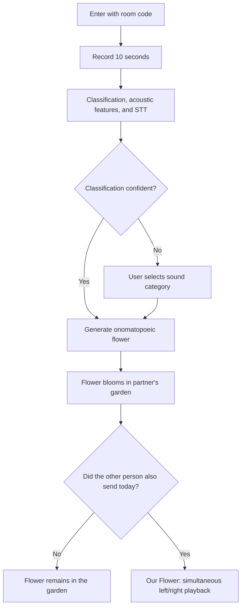

# SUP (소리숲) — Product Requirements Document

**Date:** November 6, 2026  
**Author:** @Yeojung

> **Slogan:** "It's okay not to say a word. Our days bloom through sound."

**Translation note:** This is an English translation of the nine-page Korean PRD. Korean onomatopoeic roots and flower names are intentionally preserved in Hangul because their sounds and syllable structures are essential to the product. The suffix **꽃** means **"flower."** Examples, priorities, and technical choices reflect the source document rather than subsequent design discussions.

---

## 1. Overview

SUP is an emotional sound-sharing app where two people exchange **10 seconds of sound each day**. Every sound blooms into a flower with a Korean onomatopoeic name, and the flowers accumulate to form a private garden shared by the two people.

### Problem Statement

- Sometimes people want to feel a loved one's presence without the burden of sending a photo or writing a long message about their day.
- Voice messages are often heard once and then buried in chat history, rarely to be found again.
- Visual elements in couple and friendship apps (such as pets or trees) usually represent activity levels rather than the content of what the two people actually shared.

### Proposed Solution

| Conventional Approach | SUP |
| --- | --- |
| A voice message disappears into chat history after being heard. | Each sound remains in the garden as a flower with its own name. |
| Visual representations are arbitrary (e.g., volume → color). | Korean sound-symbolic rules provide a basis for the flower's name and appearance. |
| Spoken words get buried in message history. | Speech-to-text (STT) preserves them as the flower's message (*꽃말*). |
| Each person listens to messages separately. | **Our Flower** lets both sounds from the same day play simultaneously, one toward each ear. |

### Hackathon Goals

- Deliver an uninterrupted, working demo of the complete journey: **Record → Generate an Onomatopoeic Flower → Shared Garden → Our Flower (Stereo Playback).**
- Make the demo interactive so judges can create a sound themselves and watch a flower bloom.

## 2. Target Users

The primary audience consists of people in close relationships who cannot meet frequently or find long conversations burdensome.

| Priority | Audience | Core Need |
| --- | --- | --- |
| Primary | Romantic partners, long-distance couples, couples separated by military service | Feel each other's everyday surroundings and voices even when a call is difficult. |
| Primary | Two close friends | Share small parts of their daily lives without the pressure to reply. |
| Secondary | Parents and children; family members living apart | Feel each other's presence without needing to ask for regular updates. |

### Key User Scenarios

1. On the subway after work, someone records 10 seconds of rain against the window and sends it. A **토도독꽃** blooms in the other person's garden.
2. Before bed, someone whispers, "You worked hard today," and sends it. A **소곤소곤꽃** blooms, with the spoken sentence preserved as its flower message.
3. On a difficult day, a user taps **Today's Comfort** and hears laughter sent by the other person a month earlier.

## 3. Functional Requirements

**Priority definitions:**

- **P0:** Required for the hackathon demo.
- **P1:** Implement if time permits.
- **P2:** Future expansion.

| ID | Feature | Priority | Requirements | Acceptance Criteria |
| --- | --- | --- | --- | --- |
| F1 | Today's Sound Recording | P0 | Record up to 10 seconds; show a waveform and remaining time while recording; allow rerecording and playback before sending. | Recording stops automatically at 10 seconds, and the user can preview the recording. |
| F2 | Sound Classification | P0 | Use YAMNet to classify sounds (environmental sounds, speech, laughter, singing, etc.). If confidence is low, let the user select a category. | Display the classification result or selectable alternatives within 3 seconds. |
| F3 | Onomatopoeic Flower Generation | P0 | Map sound category to an onomatopoeic root, then use acoustic features to select phonological variations according to Section 4. Use those features to determine flower size, color, and petal count. | Show a name such as **토도독꽃** beneath the flower, alongside a one-line explanation of why it received that name. Tapping the flower plays the original recording. |
| F4 | Flower Message (*꽃말*) | P0 | For voice-category sounds, store the STT transcription as the flower's message. The sender can edit or remove it before sending. | The flower card displays **"Flower message: …"** |
| F5 | Our Flower | P0 | If both people send a sound on the same day, generate a combined flower and name (e.g., 토독 + 도란도란 → **토독도란꽃**). When played, pan the other person's sound left and the user's sound right, simultaneously. | Listeners wearing headphones can distinguish the left and right sounds. |
| F6 | Garden That Grows Together | P0 | Place sent and received flowers in date order; distinguish the user's flowers from the partner's; do not include wilting or streak tracking. | A new flower blooms on the other person's screen in real time. |
| F7 | Two-Person Connection | P0 | Connect two people using a six-digit room code, without a conventional sign-up flow; users only enter nicknames. | Both devices display the same garden. |
| F8 | Today's Comfort | P1 | Tap a button to replay one randomly selected past recording received from the other person; highlight the corresponding flower. | One tap starts playback. |
| F9 | Sound Field Guide | P1 | Show all onomatopoeic flower roots collected so far; show uncollected roots as silhouettes. | A new root appears in the field guide when first discovered. |
| F10 | Seed Mode | P2 | Voice recordings arrive as seeds and bloom the next morning. A **fast-forward time** button is needed for demonstrations. | — |
| F11 | Sound Album & Home-Screen Widget | P2 | Play a week's recordings consecutively. Implement the widget after transitioning to a native app. | — |

### Product Principles

- Do not restrict which sounds users can send, including spoken voices. **Every sound becomes a named flower.**
- Avoid pressure-inducing mechanics such as scores, streaks, or flowers that wilt.
- Recordings must be accessible only to the two participants and deletable at any time.

## 4. Rules for Naming Onomatopoeic Flowers

Flower names are generated in two steps:

1. Select an **onomatopoeic root** based on the sound category.
2. Use acoustic features to choose the root's **vowels, consonants, and repetition pattern**.

To prevent unnatural names, the dictionary contains only predefined, valid variants. If a particular variation is unavailable, use the closest available form.

### 4.1 Extracted Acoustic Features

| Feature | Calculation | Used For |
| --- | --- | --- |
| Loudness | Mean root-mean-square (RMS) amplitude | Vowel group (positive/negative) and flower size |
| Brightness | Spectral centroid | Vowel selection and flower color |
| Attack | Maximum upward slope of the amplitude envelope | Consonant type (plain/tense/aspirated) and petal-tip shape |
| Rhythm | Number of sound events (onsets) within 10 seconds | Repetition pattern and petal count |

**Threshold calibration:** Early in the hackathon, team members record 20 sample sounds and use their median feature values as thresholds.

### 4.2 Variation Rules (Korean Sound Symbolism)

| Dimension | Condition | Result | Examples from the PRD |
| --- | --- | --- | --- |
| Vowels | Small, bright sound | Positive vowels (양성모음: ㅏ, ㅗ) | 졌졌, 똑똑, 깔깔 |
| Vowels | Large, low-pitched sound | Negative vowels (음성모음: ㅓ, ㅜ) | 줄줄, 뚝뚝, 껴껴 |
| Consonants | Weak / medium / strong attack | Plain / tense / aspirated consonants (평음 / 경음 / 격음) | 감감 / 깜깜 / 캄캄; 졌졌 / 쫐쫐 |
| Repetition | 1 onset / 2–3 onsets / 4+ onsets | Single form / base form / repeated form | 톡 / 토독 / 토독토독 |

### 4.3 Sound Category Dictionary (16 MVP Categories)

| Sound Category (YAMNet) | Base Root | Example Variants |
| --- | --- | --- |
| Rain | 토독 | 톡, 토도독, 투둑 |
| Water / Stream | 졌졌 | 쫐쫐, 줄줄 |
| Wind | 살랑 | 심렁, 윙윙 |
| Bird | 짹짹 | 짹짹짹 |
| Cat | 야옹 | 애옹 |
| Dog | 멍멍 | 왕왕, 냑냑 |
| Walking / Footsteps | 또각 | 뚜벅, 쿠당 |
| Typing | 톡톡 | 타닥타닥 |
| Cooking / Frying | 지글 | 지글지글, 치익 |
| Dishes / Cutlery | 달그량 | 덱그럭, 땡 |
| Vehicle / Subway | 덜컥 | 부릉, 덜컥덜컥 |
| Applause | 짝짝 | 짝짝짝 |
| Laughter | 깔깔 | 킥킥, 껴껴, 하하 |
| Singing / Humming | 흥얼 | 흥얼흥얼, 랄랄 |
| Whispering | 소곤소곤 | 수군수군 |
| Speech | 도란도란 | 재잘재잘 (many onsets), 왜자지껌 (loud and many onsets) |

**Fallback:** For other sounds, use **사분사분꽃** for quiet sounds or **웅웅꽃** for loud sounds.

### 4.4 Mapping Sound Features to Flower Appearance

| Feature | Flower Appearance |
| --- | --- |
| Positive vowels | Small, rounded petals; pastel colors |
| Negative vowels | Large, broad petals; deeper colors |
| Tense / aspirated consonants | Pointed petal tips |
| Number of onsets | Petal count (3–8) |
| Sound category | Color family: water/rain = blue; laughter = yellow; voice = pink; animals = orange; everyday sounds = green |

### 4.5 Naming Combined Flowers

Combine the first two syllables (or the repeating unit) of each name **in the order the recordings were sent**.

Examples:

- `토독` + `도란도란` → **토독도란꽃**
- `졌졌` + `깔깔` → **졌졌깔깔꽃**

## 5. Screens and User Flow

The MVP has **seven screens**. The user starts in the Garden (Home) and enters the main experience through a single record button.

| ID | Screen | Main Elements |
| --- | --- | --- |
| S1 | Entry | Create a garden (generate a code), enter a code, enter a nickname |
| S2 | Garden (Home) | Flower arrangement; distinguish sent vs. received flowers; bottom record button; Today's Comfort button |
| S3 | Recording | 10-second timer, live waveform, rerecord, preview |
| S4 | Flower Preview | Flower name, one-line explanation of its name, editable flower message, Send button |
| S5 | Flower Details | Playback, name, flower message, date sent, delete |
| S6 | Our Flower | Combined name, separate left and right waveforms, stereo playback |
| S7 | Sound Field Guide | List of collected roots; silhouettes for uncollected roots |

### User Flow: From a Sound to a Flower

The flow includes **two branching decisions**: ambiguous classifications require manual category selection; **Our Flower** appears only if both participants send a recording on the same day.

## 6. Technical Architecture

**Architecture principle:** Perform all audio processing in the browser and use **Supabase as the sole server-side platform**. Do not deploy a separate backend server.

| Area | Technology | Notes |
| --- | --- | --- |
| Frontend | React + Vite; mobile web (**not a PWA**) | Demo uses two mobile browsers. |
| Recording | MediaRecorder API (`webm/opus`) | iOS Safari requires an MP4 fallback. |
| Acoustic Features | Web Audio API `AnalyserNode` or Meyda | RMS, spectral centroid, and onset detection. |
| Sound Classification | YAMNet (TensorFlow.js) | Resample to 16 kHz mono and use the top three predicted classes. |
| Speech-to-Text (Flower Message) | Web Speech API (`ko-KR`) | Run concurrently with recording; use manual text entry on unsupported browsers. |
| Stereo Playback | Web Audio `StereoPannerNode` | Partner: pan `-0.8`; self: pan `+0.8`. |
| Flower Rendering | SVG + CSS animations | Generate petals using parameters. |
| Database, Storage & Realtime | Supabase (Postgres, Storage, Realtime) | Update the partner's screen on new flower insertion. |
| Deployment | Vercel | HTTPS is required for microphone permissions. |

### Data Model

| Table | Main Columns |
| --- | --- |
| `gardens` | `id`, `code` (six digits), `created_at` |
| `members` | `id`, `garden_id`, `nickname`, `created_at` |
| `flowers` | `id`, `garden_id`, `sender_id`, `audio_path`, `category`, `root`, `name`, `transcript` (flower message), `rms`, `centroid`, `attack`, `onsets`, `color`, `petals`, `sent_date`, `created_at` |
| `pair_flowers` | `id`, `garden_id`, `flower_a_id`, `flower_b_id`, `name`, `sent_date` |

### Storage, Pairing, and Access Rules

- Store audio files in a **private Supabase Storage bucket** and play them using signed URLs.
- After a record is inserted into `flowers`, the client checks whether a flower from the other participant exists in the same `garden` on the same `sent_date`. If so, create a `pair_flowers` record.
- For the hackathon, keep row-level security (RLS) simple at the garden level and use anonymous authentication.

## 7. MVP Scope and Team Responsibilities

The MVP comprises the **seven P0 features, F1–F7**.

- If automatic classification is unreliable, fall back to manual sound-category selection.
- If time runs short, replace the room-code feature (F7) with a single hardcoded room for the demonstration.

### Team Responsibilities (Four-Person Team)

| Owner | Responsibilities | Features |
| --- | --- | --- |
| A | Garden UI, SVG flower generator, animation | F3 (appearance), F6, F9 |
| B | Recording, acoustic feature extraction, YAMNet, stereo playback | F1, F2, F5 (playback) |
| C | Onomatopoeia dictionary and variation rules, STT flower messages, presentation story | F3 (names), F4, F5 (names) |
| D | Supabase, room codes, realtime updates, deployment, integration | F7, F8, deployment |

**If there are only three team members:** B also handles C's dictionary work, and all members share presentation duties.

### Implementation Timeline

**Baseline: 12 hours.** If the hackathon lasts 6 hours, compress the schedule by half.

| Time | Goal | Completion Signal |
| --- | --- | --- |
| 0–1 h | Set up repository, Supabase, and Vercel; record 20 sample sounds. | A blank screen is available at the deployment URL. |
| 1–4 h | Develop modules independently (recording/classification, SVG flowers, dictionary, database). | Each module has a standalone demo. |
| 4–7 h | Integrate recording → naming → flower → partner's screen. | Flowers can be exchanged between two phones. |
| 7–9 h | Build Our Flower, stereo playback, and flower messages. | Combined flower playback succeeds. |
| 9–10.5 h | Implement P1 features (Today's Comfort, Field Guide) and polish the design. | — |
| 10.5–12 h | Freeze code, rehearse the demo twice, and record a backup video. | Demo finishes within 90 seconds. |

## 8. Demo, Judging Strategy, and Risks

### Demo Script (90 Seconds)

1. **Phone A** records rainfall. A small blue **토도독꽃** blooms. A one-line explanation appears: "Its sound is small and clear, so it uses positive vowels; three falling beats make it *토도독*."
2. **Phone B** records a whisper: "You worked hard today." A **소곤소곤꽃** blooms, and the sentence appears as its flower message.
3. The two flowers combine into **토독소곤꽃**. When tapped, rainfall plays on the left and the whisper plays on the right.
4. Hand a phone to a judge and invite them to record clapping or laughter. A new flower blooms on the spot.
5. **Closing line:** "We shared our days through sound, and those sounds became flowers in the same way the Korean language has long given sounds their names."

**Presentation consideration:** Stereo positioning may be hard to hear through the venue's loudspeakers. Show **separate left and right waveforms** on the screen as a visual explanation.

### Judging Criteria Strategy

| Criterion | Weight | Strategy |
| --- | --- | --- |
| Completeness | 40% | Finish all seven P0 features and demonstrate realtime behavior on two phones. |
| Idea | 40% | Emphasize the linguistic grounding of sound-based names through Korean sound symbolism, plus the left/right stereo combination in Our Flower. |
| Theme Relevance | 20% | Keep the experience sound-driven throughout: recording, classification, acoustic analysis, STT, and spatial playback. |

### Risks and Mitigations

| Risk | Mitigation |
| --- | --- |
| YAMNet misclassifies sounds due to noise at the venue. | Show category-selection buttons when confidence is low; prepare prerecorded demo sounds. |
| iOS Safari recording-format incompatibility or lack of Web Speech support. | Demonstrate using Android Chrome or a laptop; allow manual entry of flower messages. |
| Unstable venue Wi-Fi. | Prepare a hotspot and record a backup demo video. |
| Awkward onomatopoeic names. | Include only established forms in the dictionary and use the base root when no suitable variant exists. |
| Privacy of personal voice recordings. | Use a private storage bucket and deletion feature; briefly communicate privacy principles during the presentation. |

### Open Questions

- [x] ~~Confirm whether the hackathon lasts 6 or 12 hours.~~ *(Marked complete in the source; the confirmed duration is not specified.)*
- [x] Service name decided: **SUP (소리숲)**.
- [ ] Secure demonstration devices (**two Android phones or a laptop**).

---

*End of translated PRD. Original: “소리숲(SOOP) PRD,” 9 pages, November 6, 2026.*
